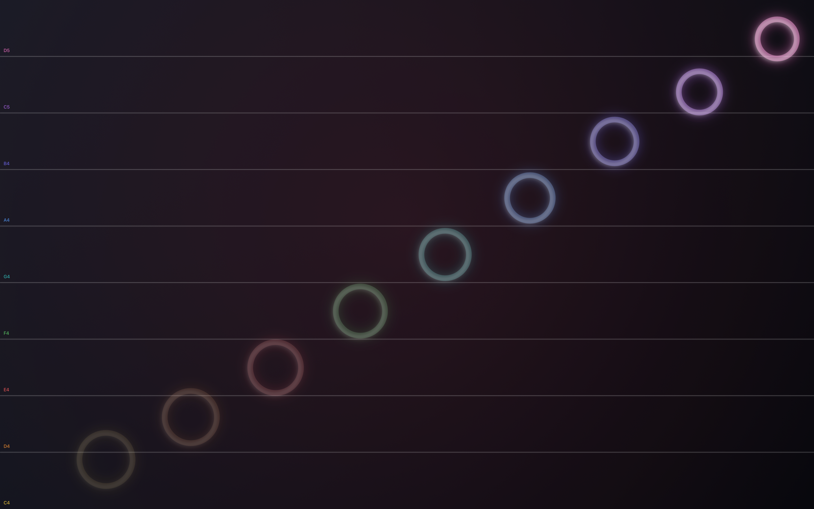

# Music Touch

A free Mac menu bar utility that turns the touchscreen on the MacBook Pro with PROLED XDR Display
into a piano. Turn it on and the whole screen becomes note zones playing a scale, nine zones of C
major from middle C (C4) up to the D above the octave (D5) by default. Touch anywhere to play, use several fingers for a
chord, or slide across the zones for a glissando. Every touch sends out a glowing ring in that note's
colour.

- **Menu bar only.** No Dock icon. Toggle it from the menu or anywhere with ⌃⌥⌘M.
- **Zones up the scale.** The root upwards, one zone per scale degree (C4 D4 E4 F4 G4 A4 B4 C5
  D5 in C major), bottom to top, or left to right in horizontal mode. Optional separator lines
  with note names.
- **Any key, major or minor, 8 to 12 zones.** Settings › Key picks the root (C through B,
  spelled for the key), major or natural minor, and how many zones share the screen: one octave
  (8 notes) up to 12. The zones resize evenly and their labels follow.
- **A soft piano.** The system's General MIDI grand piano, mellowed with a low-pass filter and a
  long hall reverb. Each zone has its own sampler so notes fade independently; the note length is
  adjustable in Settings.
- **Lid logo pulse.** On a MacBook Pro with the illuminated Apple logo, the logo can pulse with
  each note: it rests dark while Music Touch is on, lights the instant you play and goes dark again
  as the note starts to fade (direct-download version only, see below).
- **Plays through the current output.** Notes go to the Mac's default audio output and follow it
  when you switch to headphones, AirPods or a display.
- **Blocks the screen while on.** The overlay sits above every window and the Dock, just under the
  menu bar, so a touch never lands in the app underneath. Turn Music Touch off to get back to work.
- Works with a mouse or trackpad too, so it runs on any Mac with macOS 27 or later.

Nothing is collected or sent anywhere. There is no account, no analytics and no network access.

## Install

- **Free download** (recommended): [beardfm.app/music-touch](https://beardfm.app/music-touch/).
  Signed and notarized. This version can install the lid-logo helper.
- **Mac App Store**: the same app, sandboxed, without the lid-logo helper (the sandbox doesn't allow
  installing a launch daemon).

## How touches arrive

macOS 27 delivers finger touches to an app only through gesture recognizers, never through the
responder chain's `touchesBegan(with:)` or event monitors (Apple Technote TN3212). The overlay
therefore installs a tiny `NSGestureRecognizer` subclass with `allowedTouchTypes = .direct` that
forwards every touch to the view. Clicks still work for Macs without a touchscreen, and the click
macOS synthesizes for a tap is recognised as an echo of the finger and ignored, so a tap plays once.
Settings › Status shows whether the last note came from a touch or a click.

## How the lid logo pulse works

macOS exposes exactly one control for the lid logo: the `LEBacklightMode` preference in the root
`com.apple.CoreBrightness` domain, documented in
[Apple's support article](https://support.apple.com/en-us/149248). Writing it needs root, so
Settings › Apple Logo › Install Helper… installs a tiny launch daemon (with your administrator
password, once). It listens on a named pipe at `/Users/Shared/MusicTouch/logo-control` for the words
`on` and `off` and flips that preference. While Music Touch is on with pulsing enabled the app
keeps the logo dark, switches it on the instant a note is struck and off again when the note
starts to fade (40% of the Note length), and leaves it lit when Music Touch is turned off or
quits. macOS sets the logo's brightness from the display and ambient light and exposes only the
switch, so the logo cuts rather than fades. Uninstall Helper… removes everything and leaves the logo lit.

## Building

Open `Music Touch.xcodeproj` in Xcode 27 or later and run. There are two targets:

- **Music Touch**: the direct download. Links [Sparkle](https://sparkle-project.org) for in-app
  updates from `https://beardfm.app/music-touch/appcast.xml` (`Config/Info.plist`).
- **Music Touch App Store**: the same sources built with the `APPSTORE` condition, sandboxed and
  without Sparkle; the App Store delivers its updates.

`Tools/release.sh --notarize --upload` builds, signs and notarizes the DMG, signs it for Sparkle and
adds it to the appcast in the beardfm.app site checkout; `Tools/archive-appstore.sh` archives and
uploads the App Store target.

- `Tools/release.sh [--notarize] [--upload]` builds a Release app signed with Developer ID, packages
  a DMG, and optionally notarizes it and copies it into the beardfm.app site checkout.
- `Tools/archive-appstore.sh` archives the sandboxed App Store build and uploads it to App Store
  Connect. `Tools/appstore.mjs` fills in the listing from `AppStore/metadata.md`, uploads the
  screenshots in `AppStore/screenshots`, attaches the build and submits for review.
- `swift Tools/make-icon.swift` regenerates the app icon from code.

## Project layout

| File | What it does |
| --- | --- |
| `MusicTouchApp.swift` | App entry, menu bar menu, Settings scene |
| `AppState.swift` | Settings persistence and the on/off state; wires overlay, audio, logo and hotkey together |
| `OverlayController.swift` | The full-screen, non-activating panel over the touchscreen |
| `OverlayView.swift` | Direct-touch gesture recognizer and mouse handling, glissando tracking, rings and separator lines |
| `NoteZone.swift` | Zone geometry, MIDI notes, note names and colours |
| `PianoEngine.swift` | AVAudioEngine graph: one sampler per zone, low-pass, reverb, per-zone fades; follows the default output device |
| `LidLogoController.swift` | Lid logo pulse and the privileged helper installer |
| `AppUpdater.swift` | Sparkle updater for the direct download (a stub in the App Store build) |
| `GlobalHotKey.swift` | Carbon hot key for ⌃⌥⌘M |
| `SettingsView.swift` | The Settings window |

## License

MIT. See [LICENSE](LICENSE).
